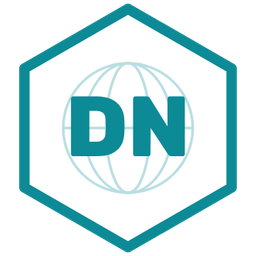

<p align="center"></p>

# Gov5 Gateway: verify it or disprove it

Gov5 Gateway, by DeBacco Nexus, sits between an organization's AI agents and the AI model. Every request passes through it. Each one is checked before any AI runs, and then it is let through, held for a person, or refused. Every decision gets a signed receipt.

This repository is here so you don't have to take our word for any of it. Run it, read it, and try to break it. If you find something wrong, tell us (see the end of this page).

## What we claim, and how to check each claim

| Claim | How to check it |
|---|---|
| A request that breaks a rule is stopped **before** the AI model runs. | The tests use a stand-in model that counts every call, so they can show which requests reached it. `noteReaderNeverReachedModel`, `sleeperHeld` and `blocked` fail if a stopped request ever reaches it. |
| A held request waits for a person and does nothing until one decides. | `held`, `approvalFlow` and `pendingHoldFrozen`. In the video, the receipt reads "Who decided: No one yet." |
| Each agent works under its own charter: an owner, a job, and how many helpers it may start. | `spawnRefused`, `maxChildren`, `ownerInherited`, `onTaskPasses`, `offTaskHeld`. |
| You can stop one agent and everything it started while the other agents keep working. | `lineageQuarantined`, `othersKeepWorking`, `countsReconcile`. |
| Agents passing a hidden code to one another, with no handoff connecting them, are caught. | `noteLeftIsFlagged`, `noteReaderHeld`, and `sameLineageNotACovertChannel` (the same code inside one family of agents is not flagged). |
| "Stop all agents" stops every agent at once, and the stop gets its own receipt. | `agentCannotStopAll`, `stopAll`, `stopReceipted`. |
| Every receipt is signed, and any change to it breaks the signature. | `receipt`, `qrPublicCheck`. The swarm test checks a sample of receipts against the public key. |
| Official AI client libraries work after changing only the address and the key. | `sdkCreate`, `sdkStream`, `sdkTools`, `openai`. These use the real Anthropic and OpenAI client libraries. |

## Run it yourself

You need Node.js 18 or newer. Nothing here calls a real AI model and nothing costs money: the tests start their own stand-in model, and every run makes its own fresh signing key.

```bash
git clone https://github.com/debacconexus/gov5-gateway-verify
cd gov5-gateway-verify
npm install
npm test                     # Gateway acceptance (34 checks) and agent charter (22 checks)
npm run test:swarm           # 300 agents at once: charters, helpers, sleepers, stop-all, receipts
```

Each test prints its results as JSON, ending in `"failures": []` when everything passes. Raw results and a SHA-256 manifest are written to `test/evidence/`. The copies in this repository come from our own run, so you can compare them with yours.

### Our results (November 5, 2026)

- **Gateway acceptance:** 34 of 34 checks passed.
- **Agent charter:** 22 of 22 checks passed.
- **Swarm, 300 agents:**
  - 300 charters issued.
  - 900 requests: 882 worked, 24 were held for a person, 66 were refused.
  - Helpers: 20 allowed, 10 refused by charter limits.
  - Sleepers that woke up and reached the model: 0.
  - After stop-all, 60 of 60 attempts were refused.
  - 63 of 63 sampled receipts verified.
  - Time added by the checks, with one request at a time: 7.1 ms median.

These timings come from one small cloud machine. Yours will differ.

### Watch it, or record it yourself

`docs/many-at-once.mp4` (39 seconds) is a real screen recording of the console with 1,000 demo agents:

1. Eight agents break eight different rules in the same second.
2. Each one is held, refused or stopped, while the others keep finishing their work.
3. The video then opens a receipt that is waiting for a person.

You can make the same recording yourself, from nothing:

```bash
npx playwright install chromium
npm run record               # fresh Gateway, 1,000 stand-in agents, phone-sized browser
ffmpeg -f concat -safe 0 -i demo/out/list.txt -vf "fps=30,tpad=stop_mode=clone:stop_duration=6,format=yuv420p" -c:v libx264 -crf 20 demo/out/many-at-once.mp4
```

Agent numbers and times will differ from ours, because the eight rule-breakers are picked at random each run.

### Open the console

```bash
GATEWAY_ADMIN_KEY=pick-any-long-secret GATEWAY_ENC_KEY=$(openssl rand -hex 32) npm start
```

Open http://127.0.0.1:8080/console and sign in with the admin key. On the Agents page, "Load demo agents" builds Sample Bank (demo), a made-up bank with 1,000 agents. Then try **Run live**, **Secret notes** or **Many at once**.

## Where it stops, in plain words

We would rather you read these here than discover them yourself:

- **It only sees what goes through it.** The Gateway governs requests sent to the AI model through it. An agent that reaches a model some other way, or that writes directly to a shared file or database, is outside what it can see.
- **Off-task and secret-note checks match words and patterns.** They do not understand meaning. An agent that hides its intent in ordinary words, or passes a note in a form without a code-like mark, can get past them. Meaning-based checks are not built yet.
- **The demo is a stand-in.** The 1,000 demo agents talk to a stand-in, not a real AI. Their receipts say so: "demo stand-in (no AI model was called)".
- **A signature shows the receipt has not changed since it was signed.** It does not show that what the receipt describes is true. That depends on the Gateway code doing what it says, which is why the code is here.
- **Some checks need a person.** A held request waits until someone decides. If no one decides, the work does not happen.

## Try to break it

Good places to push:

- Get a request to the model that should have been held.
- Make an agent start more helpers than its charter allows.
- Pass a secret note between two agents without being caught.
- Change a receipt and still have it verify.
- Make "stop all" miss an agent.
- Make the containment counts not add up.

Every test file says at the top what it does. Most checks are short and readable.

## What is in this repository

- `server.cjs`: the whole Gateway server, including signed receipts and the hold reviewer routes.
- `lib/`: the Gateway's checks, the agent charters, receipts, alerts and the console's back end.
- `public/`: the console, the public receipt check page, and Oshi's Cube (a teaching game that drives real demo agents).
- `test/`: the tests and our evidence. `demo/`: the recording script. `docs/`: the video.

This is the Gateway alone. DeBacco Nexus's other systems are not in this repository.

## Tell us what you find

Email **info@debacconexus.com**, or open an issue on this repository. Please include what you ran, what you expected, and what happened. We will answer, and we will fix what is wrong.

---

Copyright 2026 DeBacco Nexus LLC. Patent pending, U.S. Application 19/571,156. This code is published so anyone can read, run and test it to verify or disprove it. No other license is granted.
